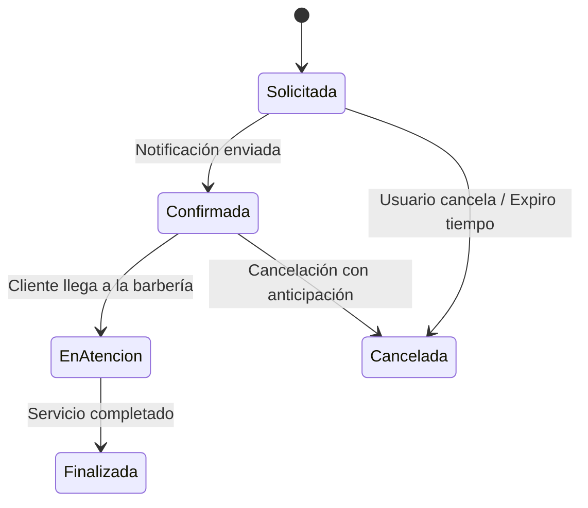
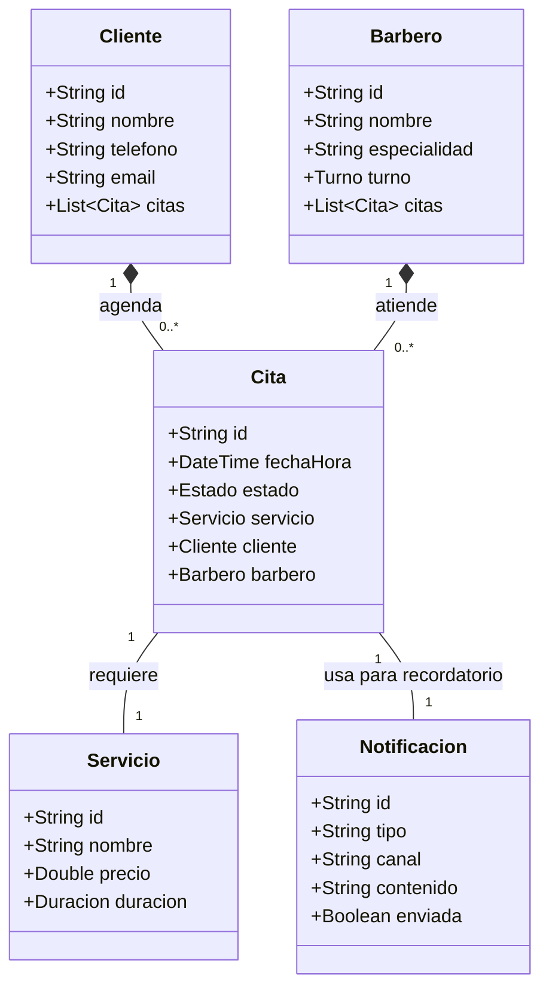
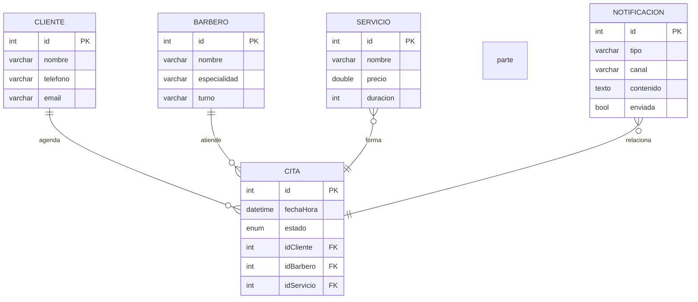
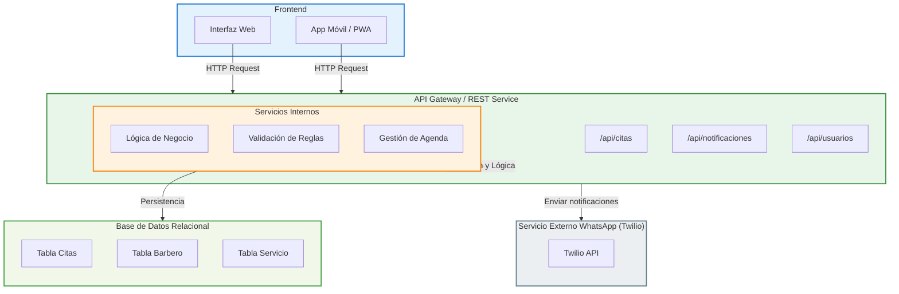

# DOCUMENTO DISEÑO: BarberFlow

## 5.1 Comprensión del Problema

### 5.1.1 Contexto de la Barbería/Estética BarberFlow
BarberFlow es un sistema diseñado para digitalizar y optimizar la gestión de citas y servicios en un negocio local de barbería/estética. El negocio actualmente enfrenta desafíos en la gestión manual de agendamientos, falta de control sobre la disponibilidad de barberos en tiempo real y la imposibilidad de enviar recordatorios automáticos a clientes, lo que genera citas olvidadas y huecos sin llenar en la agenda diaria.

### 5.1.2 Situación Actual
El proceso actual es totalmente manual: los clientes llaman o acuden personally para agendar citas, el barbero lleva un registro físico en una agenda y el administrador no tiene visibilidad sobre métricas de ocupación, ingresos o desempeño del personal. Esta situación genera sobrecostos, errores de programación y baja satisfacción del cliente debido a tiempos de espera innecesarios.

### 5.1.3 Problema Identificado
La falta de un sistema digitalizado impide una gestión eficiente del ciclo de vida de las citas, resulta en superposiciones de horarios, falta de recordatorios automatizados y imposibilidad de generar reportes basados en datos reales. El negocio necesita transformar sus operaciones para competir en un mercado cada vez más digital.

### 5.1.4 Actores
1. **Cliente**: Usuario final que requiere servicios de barbería/estética. Sus acciones incluyen explorar el catálogo de servicios, seleccionar un barbero disponible y agendar una cita con la confirmación correspondiente.
2. **Barbero/Estilista**: Profesional que brinda los servicios. Visualiza su agenda diaria, cambia estados de atención durante la jornada y registra los insumos consumidos por cada servicio.
3. **Administrador**: Gestión superior del negocio. Administra los horarios del personal, define tarifas por servicio, gestiona roles de personal y genera reportes de atención y ocupación.

### 5.1.5 Requerimientos Funcionales (RF)
- **RF1**: El sistema debe permitir al cliente explorar el catálogo de servicios disponibles con descripciones y precios.
- **RF2**: El sistema debe permitir al cliente seleccionar un barbero disponible para la cita.
- **RF3**: El sistema debe agendar citas respetando la franja horaria y disponibilidad del barbero.
- **RF4**: El sistema debe gestionar el ciclo de vida de la cita: Solicitada -> Confirmada -> En Atención -> Finalizada/Cancelada.
- **RF5**: El sistema debe enviar notificaciones automáticas vía API de WhatsApp (Twilio) para confirmaciones y recordatorios.
- **RF6**: El administrador debe poder generar reportes de ocupación, ingresos y desempeño del personal.

### 5.1.6 Requerimientos No Funcionales (RNF)
- **RNF1 (Usabilidad)**: La interfaz debe ser móvil-first y ágil, con tiempos de carga < 2 segundos en conexiones móviles estándar.
- **RNF2 (Disponibilidad)**: El sistema debe estar disponible 24/7 para agendamiento en línea, con uptime del 99.5% mensual.
- **RNF3 (Rendimiento)**: El tiempo de respuesta para consultas de agenda y estado de cita no debe exceder 500ms en condiciones normales.
- **RNF4 (Interoperabilidad)**: El sistema debe integrarse con la API de Twilio para envío de mensajes de WhatsApp y ser compatible con navegadores modernos (Chrome, Firefox, Safari).

### 5.1.7 Reglas de Negocio (RN)
- **RN1**: Un cliente no puede agendar dos citas en la misma franja horaria.
- **RN2**: Las cancelaciones deben realizarse con al menos 2 horas de anticipación para no incurrer en penalizaciones.
- **RN3**: No se permite asignar una cita a un barbero que no esté en su turno laboral programado.

## 5.2 Atributos de Calidad

### 5.2.1 Usabilidad
El atributo de usabilidad es crítico dado que el sistema será utilizado por profesionales de barbería que pueden no tener altas habilidades tecnológicas. Se justifica técnicamente porque una interfaz intuitiva y móvil-first reduce la curva de aprendizaje y aumenta la adopción del sistema. Se implementará un diseño limpio, navegación simplificada, textos claros y flujos de trabajo reducidos a mínimo número de pasos. La responsividad asegura que tanto clientes como barberos puedan usar el sistema desde tabletas o teléfonos en el entorno de la barbería.

### 5.2.2 Disponibilidad
La disponibilidad es esencial porque el sistema de agendamiento debe estar siempre accesible, especialmente durante las horas pico de reserva (mañanas y tardes tempranas). La justificación técnica radica en que cualquier caída del sistema durante estos periodos críticos resulta en pérdida de ingresos directa y frustración del cliente. Se diseñará con arquitectura que soporte alta concurrencia, uso de colas de mensajes y redundancia en la base de datos. El 99.5% de uptime mensual es el objetivo, con mecanismos de fallover y mantenimiento programado durante horas de menor actividad.

### 5.2.3 Rendimiento
El rendimiento es crucial para garantizar una experiencia de usuario fluida. La justificación técnica incluye: (1) el tiempo de respuesta < 2s para operaciones de consulta de agenda previene abandono del usuario en agendamiento móvil; (2) capacidad de manejar picos de tráfico (ej. lunes por la mañana) sin degradación significativa; (3) procesamiento eficiente de notificaciones masivas vía Twilio sin impactar el rendimiento general. Se establecerán métricas de SLA para tiempo de respuesta y se utilizará cacheo estratégico para lecturas frecuentes de datos de agenda.

### 5.2.4 Interoperabilidad
La interoperabilidad es necesaria para la integración externa obligatoria con la API de Twilio y para garantizar que el sistema funcione en diferentes ecosistemas. La justificación técnica se basa en que: (1) la integración con Twilio API requiere adherencia a especificaciones RESTful y manejo correcto de webhooks; (2) el sistema debe comunicarse con servicios externos de manera segura y confiable; (3) compatibilidad con múltiples dispositivos y sistemas operativos asegura que tanto clientes como barberos accedan desde sus plataformas preferidas. Se implementarán estándares API abiertos y documentación clara para futuras integraciones.

## 5.3 Formalización de Reglas de Negocio y Ciclo de Vida de la Cita

### 5.3.1 Reglas de Negocio (RN)
- **RN1**: Restricción de horario duplicado - Un cliente no puede agendar dos citas en la misma franja horaria.
- **RN2**: Cancelación previa de 2h - Las cancelaciones deben realizarse con al menos 2 horas de anticipación para no incurrir en penalizaciones.
- **RN3**: Validación de turno del barbero - No se permite asignar una cita a un barbero que no esté en su turno laboral programado.

### 5.3.2 Ciclo de Vida de la Cita (Diagrama de Estados Mermaid.js)

## 5.3 Diseño de Datos

### 5.3.1 Diagrama de Clases del Dominio


### 5.3.2 Modelo Entidad-Relación


### 5.3.3 Estructuras de Intercambio (DTO / JSON)

#### Solicitud de agendamiento de cita (cliente -> API)
```json
{
  "clienteId": "C001",
  "barberoId": "B005",
  "servicioId": "S003",
  "fechaHora": "2024-03-15T14:30:00",
  "tipoRecordatorio": "24h_y_1h"
}
```

#### Payload JSON API Twilio (para confirmación de cita)
```json
{
  "to": "+5491123456789",
  "body": "Hola María! Tu cita de corte y barba está confirmada para el 15/03 a las 14:30 con el barbero Juan. Te esperamos! 💈",
  "from": "+15017122661",
  "statusCallback": "https://barberflow.com/webhook/twilio"
}
```

## 5.4 Diseño Arquitectónico

### 5.4.1 Análisis Comparativo de Alternativas Arquitectónicas

| Aspecto | Monolito MVC | Arquitectura Cliente-Servidor Desacoplada |
|---------|--------------|------------------------------------------|
| **Estructura** | Lógica de negocio, vista y datos en una sola unidad | Frontend (Web/Móvil) separado del backend/API |
| **Despliegue** | Single deployment unit | Desplegable independiente de componentes |
| **Escalabilidad** | Escalado vertical limitado | Escalado horizontal de servicios individuales |
| **Maintenance** | Cambios afectan todo el sistema | Modificaciones aisladas por capas |
| **Tecnología** | Generalmente un solo stack | Flexibilidad para usar diferentes tech stacks |

### 5.4.2 Justificación Técnica de la Selección

Se seleccionó la arquitectura **Cliente-Servidor Desacoplada** por las siguientes razones técnicas:

1. **Acceso desde dispositivos móviles**: La separación del frontend permite desarrollar una interfaz optimizada para móvil (responsive design, PWA) sin restricciones del backend. Los clientes pueden acceder desde teléfonos, tablets o navegadores desktop con la misma API subyacente.

2. **Escalabilidad**: La arquitectura permite escalar Independientemente los componentes. Durante horas pico de reserva (mañanas/lunes), se puede escalar solo el servicio de API o la base de datos sin necesidad de replicar todo el monolito. Esto es crítico para BarberFlow que debe manejar picos de demanda.

3. **Integración de servicios de terceros**: La arquitectura desacoplada facilita la integración con APIs externas como Twilio (WhatsApp), servicios de pago, y sistemas de terceros. Cada integración es un servicio independiente que consuma la API REST sin afectar el resto del sistema.

4. **Desarrollo paralelo**: Los equipos pueden trabajar en el frontend (experiencia de usuario) y backend (lógica de negocio) de forma simultánea y independiente, acelerando el tiempo de mercado.

### 5.4.3 Descarte de la Opción Monolítica

La arquitectura Monolito MVC fue descartada por las siguientes razones:

- **Limitaciones de movilidad**: Un monolito tradicional está diseñado típicamente para navegadores web desktop, lo que dificulta la creación de una experiencia de usuario fluida en dispositivos móviles sin comprometer el rendimiento.

- **Acoplamiento estrecho**: Cualquier cambio en la lógica de negocio o en la base de datos requiere despliegue completo del sistema, aumentando el riesgo de errores en producción y tiempo de inactividad.

- **Escalabilidad ineficiente**: Para escalar, es necesario replicar toda la aplicación (incluyendo controladores y vistas) en lugar de escalar solo los componentes críticos (procesamiento de citas, notificaciones, etc.).

- **Integración compleja**: La incorporación de servicios externos como Twiary API requiere modificaciones directas en el código del monolito, aumentando la complejidad y el riesgo de romper funcionalidades existentes.

### 5.4.4 Diagrama de Arquitectura Seleccionada


### 5.4.5 Riesgos Técnicos y Trade-offs

| Riesgo | Descripción | Mitigación |
|--------|-------------|------------|
| **Latencia de red** | La comunicación entre capa cliente y API introduce latencia adicional comparado con monolito local. | Uso de caché estratégico (Redis), optimización de queries, y despliegue de API en regiones geográficas cercanas a los usuarios. |
| **Complejidad operativa** | Más componentes para monitorear, desplegar y mantener (servers, databases, APIs). | Implementación de DevOps con CI/CD automatizado, uso de contenedores (Docker) y orquestación (Kubernetes). |
| **Consistencia de datos** | La eventual consistency en distribuciones descentralizadas puede causar discrepancias temporales. | Diseño de transacciones con patrón Saga, y estrategias de resolución de conflictos bien definidas. |
| **Costos de infraestructura** | Necesidad de servidores adicionales para la capa API y servicios de mensajería. | Evaluación de provedores cloud con modelos pay-per-use, optimización de recursos durante horas valle. |
| **Costo de desarrollo inicial** | Requiere más tiempo de diseño y configuración inicial. | Prototipado rápido, uso de frameworks (Node.js/Express, Django, Spring Boot) que facilitan la creación rápida de APIs. |

**Trade-offs aceptados:** Se compensa la mayor complejidad operativa y costos iniciales con ganancias significativas en escalabilidad, mantenibilidad a largo plazo, y capacidad de integrar fácilmente nuevos servicios (como la obligatoria integración WhatsApp), lo que es crítico para el éxito comercial de BarberFlow.

## 5.5 Diseño de Interfaces

 ### 5.5.A Interfaz de Usuario

**Descripción detallada del flujo de navegación:**

El sistema BarberFlow consta de 4 pantallas principales por las que el usuario navega de manera secuencial:

1. **Pantalla 1: Inicio de Sesión y Selección de Rol** - Al acceder al sistema, el usuario debe identificarse y seleccionar su rol (Cliente, Barbero o Administrador). Esta pantalla determina la ruta posterior dentro del aplicativo.

2. **Pantalla 2: Catálogo de Servicios, Selección de Barbero y Selección de Fecha/Hora** - Una vez identificado el rol, el usuario accede al catálogo de servicios disponibles. El cliente puede explorar servicios, seleccionar el barbero disponible y elegir la fecha y hora de la cita.

3. **Pantalla 3: Resumen y Confirmación de Reserva con envío de alerta por WhatsApp** - Se muestra un resumen de la cita seleccionada (fecha, hora, barbero, servicio) y el monto total. Incluye un botón para confirmar la reserva, que desencadena el envío automático de una notificación por WhatsApp mediante la integración con Twilio API.

4. **Pantalla 4: Dashboard y Agenda Diaria del Barbero** - El barbero accede a su agenda diaria con todas las citas programadas, puede cambiar estados de atención (Solicitada -> Confirmada -> En Atención -> Finalizada/Cancelada), y registrar insumos consumidos por cada servicio.

**Cómo las pantallas satisfacen los principios de usabilidad:**

- **Navegación clara**: La progresión es lineal y lógica (Login → Catálogo → Confirmación → Dashboard), con indicadores visuales de posición en el flujo. Las transiciones entre pantallas son suaves y el contexto se mantiene.
- **Prevención de errores**: Validaciones en tiempo real (horarios disponibles, conflictos de doble reserva, turnos laborales), confirmaciones antes de acciones críticas (cancelación con penalización, confirmación de reserva), y campos obligatorios marcados claramente.
- **Visibilidad del estado**: Cada pantalla muestra el estado actual del sistema (usuario identificado, cita seleccionada, reserva confirmada, agenda actualizada). Los cambios de estado se reflejan inmediatamente con retroalimentación visual.
- **Retroalimentación**: Cada acción del usuario recibe una respuesta inmediata (mensajes de éxito/Error, carga spinners, actualizaciones de agenda). Las notificaciones por WhatsApp confirman la entrega al usuario. Uso de colores consistentes (verde para éxito, rojo para errores, amarillo para advertencias).

[https://www.figma.com/file/barberflow-prototype-ds]

### 5.5.B Interfaces Internas

#### Servicio CitaService
El servicio `CitaService` es el componente central que encapsula la lógica de negocio relacionada con el ciclo de vida de las citas. Funciona como un servicio de bajo nivel que puede ser consumido por capas superiores o por la API REST externa.

**Contrato del servicio (API interna):**

```
interface CitaService {
  // Operaciones de creación y gestión de citas
  crearCita(datosCita: DatosCitaInput): Promise<ResultadoCita>
  cancelarCita(citaId: string, razon?: string): Promise<ResultadoCancelacion>
  obtenerAgendaBarbero(barberoId: string, fecha: Date): Promise<AgendaBarbero>
  confirmarCita(citaId: string): Promise<Cita>
  finalizarCita(citaId: string, observaciones?: string): Promise<Cita>
  
  // Consultas de estado y historial
  obtenerEstadoCita(citaId: string): Promise<EstadoCita>
  listarCitasCliente(clienteId: string, fechaInicio?: Date, fechaFin?: Date): Promise<Cita[]>
  listarCitasBarbero(barberoId: string, fechaInicio?: Date, fechaFin?: Date): Promise<Cita[]>
}
```

**Tipos de datos de entrada:**

```
interface DatosCitaInput {
  clienteId: string;
  barberoId: string;
  servicioId: string;
  fechaHora: Date;
  tipoRecordatorio?: '24h' | '1h' | 'nenhum';
}

interface DatosValidacionHorario {
  barberoId: string;
  fechaHora: Date;
  exclusiones?: string[]; // IDs de citas existentes a excluir
}

interface DatosTurnoLaboral {
  barberoId: string;
  diaSemana: number; // 0-6 (domingo-sábado)
  horaInicio: string; // formato HH:MM
  horaFin: string; // formato HH:MM
}
```

**Resultados esperados:**

```
interface ResultadoCita {
  citaId: string;
  estado: 'Solicitada' | 'Confirmada' | 'EnAtención' | 'Finalizada' | 'Cancelada';
  mensaje: string;
  notificacion?: NotificacionData;
}

interface ResultadoCancelacion {
  cancelada: boolean;
  reembolso?: boolean;
  mensaje: string;
  penalizacion: boolean; // true si se aplicó penalización por cancelación < 2h
}

interface AgendaBarbero {
  fecha: string;
  citas: CitaAgendada[];
  huecosDisponibles: Hueco[];
}

interface CitaAgendada {
  citaId: string;
  clienteNombre: string;
  servicioNombre: string;
  horaInicio: string;
  horaFin: string;
  estado: EstadoCita;
}
```

**Excepciones/errores posibles:**

```
enum CitaErrorCode {
  BARBERO_NO_DISPONIBLE = 'BARBERO_NO_DISPONIBLE',
  HORA_YA_OCCUPADA = 'HORA_YA_OCCUPADA',
  BARBERO_FUERA_DE_TURNO = 'BARBERO_FUERA_DE_TURNO',
  CANCELACION_TARDIA = 'CANCELACION_TARDIA',
  CITA_NO_ENCONTRADA = 'CITA_NO_ENCONTRADA',
  VALIDACION_FALLIDA = 'VALIDACION_FALLIDA',
  BASE_DATOS_NO_DISPONIBLE = 'BASE_DATOS_NO_DISPONIBLE'
}

interface ErrorCita {
  codigo: CitaErrorCode;
  mensaje: string;
  detalles?: any;
  campo?: string; // campo inválido, si aplica
}
```

---

### 5.5.C Interfaces Externas

#### Integración con Twilio WhatsApp API

**Propósito de la integración:**
Envio automático de notificaciones y recordatorios de citas a través de WhatsApp, canal preferido por la mayoría de los clientes del segmento de barbería/estética. La integración cubre:
- Confirmación de reserva inmediatamente después del agendamiento
- Recordatorio de 24 horas antes de la cita
- Recordatorio de 1 hora antes de la cita
- Notificaciones de cambio de estado (cita en atención, finalizada)
- Confirmación de cancelación

**Información enviada/recibida:**

| Dirección | Campo | Tipo | Descripción |
|-----------|-------|------|-------------|
| **Enviar (POST)** | `to` | string | Número de teléfono del cliente en formato E.164 (ej: +54911987654321) |
| | `body` | string | Mensaje de texto con detalles de la cita |
| | `from` | string | Número de WhatsApp empresarial proporcionado por Twilio |
| | `statusCallback` | string | URL webhook para notificar el estado de entrega |
| **Recibir (GET/webhook)** | `MessageSid` | string | Identificador único del mensaje |
| | `MessageStatus` | string | Estado: sent, delivered, read, failed, rejected |
| | `NumMedia` | number | Número de archivos multimedia adjuntos |
| | `Body` | string | El cuerpo del mensaje recibido (si es respuesta del cliente) |
| | `Wallet` | object | Información de cobro (si aplica) |

**Formato y mecanismo (HTTP REST/JSON):**

```
Método: POST
URL: https://api.twilio.com/2010-04-01/Accounts/{AccountSid}/Messages.json

Ejemplo de petición:
```bash
curl -X POST "https://api.twilio.com/2010-04-01/Accounts/ACxxxxxxxxxxxxxxxxx/Messages.json" \
     --data-urlencode "Body=Hola María! Tu cita de corte y barba está confirmada para el 15/03 a las 14:30 con el barbero Juan. Te esperamos! 💈" \
     --data-urlencode "From=+15017122661" \
     --data-urlencode "To=+5491123456789" \
     -u "ACxxxxxxxxxxxxxxxxx:your_auth_token"
```

**Ejemplo de respuesta exitosa (201 Created):**
```json
{
  "sid": "SMxxxxxxxxxxxxxxxxx",
  "status": "queued",
  "date_created": "2024-03-10T14:30:00Z",
  "date_updated": "2024-03-10T14:30:00Z",
  "url": "https://api.twilio.com/2010-04-01/Accounts/ACxxxxxxxxxxxxxxxxx/Messages/SMxxxxxxxxxxxxxxxxx.json"
}
```

**Autenticación por Token:**
- Se utilizan credenciales de cuenta de Twilio (Account SID y Auth Token)
- Autenticación HTTP Basic: `Authorization: Basic <base64 de AccountSid:authToken>`
- Las credenciales se almacenan de forma segura en variables de entorno y/o AWS Secrets Manager
- El token se rota cada 90 días como práctica de seguridad
- Las URLs de webhook deben ser accesibles públicamente (usando ngrok en desarrollo, dominio público en producción)

**Manejo de errores:**

| Código HTTP | Significado | Acción |
|-------------|-------------|--------|
| 200-201 | Éxito | Marcar notificación como enviada, registrar SID de Twilio |
| 400 | Bad Request | Validar números de teléfono, formato de mensaje; registrar error y notificar al equipo |
| 401 | Unauthorized | Credenciales inválidas; detener envíos y solicitar renovación de token |
| 403 | Forbidden | Número bloqueado o restricciones de cuenta; revisar configuración Twilio |
| 429 | Too Many Requests | Retry con backoff exponencial (máx 3 intentos en 24h) |
| 500 | Internal Server Error | Retry con backoff exponencial; si persiste, alertar al equipo operativo |
| 503 | Service Unavailable | Retry con backoff exponencial; el servicio Twilio puede estar en mantenimiento |

**Errores de validación de negocio:**
- `NUMERO_BLOQUEADO`: El número del cliente ha bloqueado mensajes de WhatsApp de esta fuente
- `CONTENIDO_INVALIDO`: El mensaje no cumple con las políticas de contenido de Twilio
- `LIMITE_MENSAJES_EXCEDIDO`: Se ha excedido el límite de mensajes por día en la cuenta de Twilio

**Comportamiento cuando el servicio externo no está disponible:**

1. **Fallback inmediato:** Si Twilio no responde después de 5 segundos, el sistema continúa el flujo normal de agendamiento/cancelación marcando la notificación como "pendiente".

2. **Cola de reintentos:** Las notificaciones fallidas se colocan en una cola de retry con los siguientes parámetros:
   - Máximo de 3 intentos de reenvío
   - Backoff exponencial: 1min, 5min, 30min entre intentos
   - Ventana de 24 horas para completar todos los reintentos

3. **Marcado en base de datos:** Cada cita/register notification tiene un campo `notificacionWhatsApp.enviada: boolean` y `notificacionWhatsApp.intentos: number` y `notificacionWhatsApp.ultimoIntento: datetime`.

4. **Notificación alternativa:** Si después de 3 intentos la notificación falla, el sistema:
   - Marca la notificación como `enviada: false` y `fallback: true`
   - Genera un registro de error para revisión manual
   - Envía un email alternativo (si el cliente tiene email registrado)
   - Muestra un badge/indicador en el panel de control administrativo indicando "recordatorios no enviados"
   - Permite al administrador reenviar la notificación manualmente desde la interfaz

5. **Continuidad del servicio:** El agendamiento, cancelación y otras operaciones del sistema funcionan independientemente del estado de Twilio. La falta de notificación WhatsApp no impide la operación de la cita, solo reduce la tasa de recordatorios automáticos.

6. **Monitoreo y alertas:** Se establecen umbrales de alerta:
   - > 5 fallos en 1 hora → alerta por email al equipo de desarrollo
   - > 20 fallos en 24 horas → alerta SMS al líder técnico
   - Registros en Datadog/New Relic para monitoreo de SLA de la integración (objetivo: > 95% de éxito en envío)


