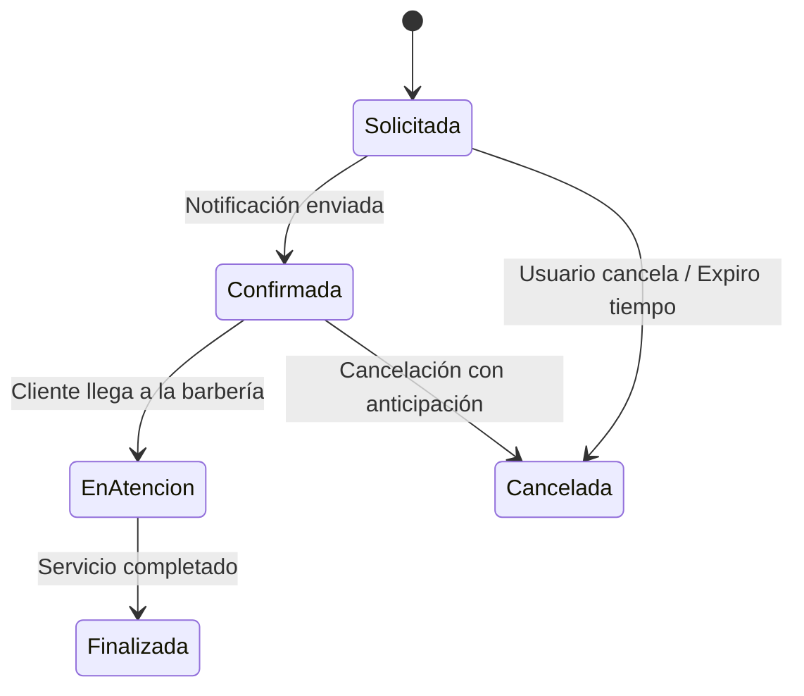

# DOCUMENTO DISEÑO: BarberFlow

## 5.1 Comprensión del Problema

### 5.1.1 Contexto de la Barbería/Estética BarberFlow
BarberFlow es un sistema diseñado para digitalizar y optimizar la gestión de citas y servicios en un negocio local de barbería/estética. El negocio actualmente enfrenta desafíos en la gestión manual de agendamientos, falta de control sobre la disponibilidad de barberos en tiempo real y la imposibilidad de enviar recordatorios automáticos a clientes, lo que genera citas olvidadas y huecos sin llenar en la agenda diaria.

### 5.1.2 Situación Actual
El proceso actual es totalmente manual: los clientes llaman o acuden personally para agendar citas, el barbero lleva un registro físico en una agenda y el administrador no tiene visibilidad sobre métricas de ocupación, ingresos o desempeño del personal. Esta situación genera sobrecostos, errores de programación y baja satisfacción del cliente debido a tiempos de espera innecesarios.

### 5.1.3 Problema Identificado
La falta de un sistema digitalizado impide una gestión eficiente del ciclo de vida de las citas, resulta en superposiciones de horarios, falta de recordatorios automatizados y imposibilidad de generar reportes basados en datos reales. El negocio necesita transformar sus operaciones para competir en un mercado cada vez más digital.

### 5.1.4 Actores
1. **Cliente**: Usuario final que requiere servicios de barbería/estética. Sus acciones incluyen explorar el catálogo de servicios, seleccionar un barbero disponible y agendar una cita con la confirmación correspondiente.
2. **Barbero/Estilista**: Profesional que brinda los servicios. Visualiza su agenda diaria, cambia estados de atención durante la jornada y registra los insumos consumidos por cada servicio.
3. **Administrador**: Gestión superior del negocio. Administra los horarios del personal, define tarifas por servicio, gestiona roles de personal y genera reportes de atención y ocupación.

### 5.1.5 Requerimientos Funcionales (RF)
- **RF1**: El sistema debe permitir al cliente explorar el catálogo de servicios disponibles con descripciones y precios.
- **RF2**: El sistema debe permitir al cliente seleccionar un barbero disponible para la cita.
- **RF3**: El sistema debe agendar citas respetando la franja horaria y disponibilidad del barbero.
- **RF4**: El sistema debe gestionar el ciclo de vida de la cita: Solicitada -> Confirmada -> En Atención -> Finalizada/Cancelada.
- **RF5**: El sistema debe enviar notificaciones automáticas vía API de WhatsApp (Twilio) para confirmaciones y recordatorios.
- **RF6**: El administrador debe poder generar reportes de ocupación, ingresos y desempeño del personal.

### 5.1.6 Requerimientos No Funcionales (RNF)
- **RNF1 (Usabilidad)**: La interfaz debe ser móvil-first y ágil, con tiempos de carga < 2 segundos en conexiones móviles estándar.
- **RNF2 (Disponibilidad)**: El sistema debe estar disponible 24/7 para agendamiento en línea, con uptime del 99.5% mensual.
- **RNF3 (Rendimiento)**: El tiempo de respuesta para consultas de agenda y estado de cita no debe exceder 500ms en condiciones normales.
- **RNF4 (Interoperabilidad)**: El sistema debe integrarse con la API de Twilio para envío de mensajes de WhatsApp y ser compatible con navegadores modernos (Chrome, Firefox, Safari).

### 5.1.7 Reglas de Negocio (RN)
- **RN1**: Un cliente no puede agendar dos citas en la misma franja horaria.
- **RN2**: Las cancelaciones deben realizarse con al menos 2 horas de anticipación para no incurrer en penalizaciones.
- **RN3**: No se permite asignar una cita a un barbero que no esté en su turno laboral programado.

## 5.2 Atributos de Calidad

### 5.2.1 Usabilidad
El atributo de usabilidad es crítico dado que el sistema será utilizado por profesionales de barbería que pueden no tener altas habilidades tecnológicas. Se justifica técnicamente porque una interfaz intuitiva y móvil-first reduce la curva de aprendizaje y aumenta la adopción del sistema. Se implementará un diseño limpio, navegación simplificada, textos claros y flujos de trabajo reducidos a mínimo número de pasos. La responsividad asegura que tanto clientes como barberos puedan usar el sistema desde tabletas o teléfonos en el entorno de la barbería.

### 5.2.2 Disponibilidad
La disponibilidad es esencial porque el sistema de agendamiento debe estar siempre accesible, especialmente durante las horas pico de reserva (mañanas y tardes tempranas). La justificación técnica radica en que cualquier caída del sistema durante estos periodos críticos resulta en pérdida de ingresos directa y frustración del cliente. Se diseñará con arquitectura que soporte alta concurrencia, uso de colas de mensajes y redundancia en la base de datos. El 99.5% de uptime mensual es el objetivo, con mecanismos de fallover y mantenimiento programado durante horas de menor actividad.

### 5.2.3 Rendimiento
El rendimiento es crucial para garantizar una experiencia de usuario fluida. La justificación técnica incluye: (1) el tiempo de respuesta < 2s para operaciones de consulta de agenda previene abandono del usuario en agendamiento móvil; (2) capacidad de manejar picos de tráfico (ej. lunes por la mañana) sin degradación significativa; (3) procesamiento eficiente de notificaciones masivas vía Twilio sin impactar el rendimiento general. Se establecerán métricas de SLA para tiempo de respuesta y se utilizará cacheo estratégico para lecturas frecuentes de datos de agenda.

### 5.2.4 Interoperabilidad
La interoperabilidad es necesaria para la integración externa obligatoria con la API de Twilio y para garantizar que el sistema funcione en diferentes ecosistemas. La justificación técnica se basa en que: (1) la integración con Twilio API requiere adherencia a especificaciones RESTful y manejo correcto de webhooks; (2) el sistema debe comunicarse con servicios externos de manera segura y confiable; (3) compatibilidad con múltiples dispositivos y sistemas operativos asegura que tanto clientes como barberos accedan desde sus plataformas preferidas. Se implementarán estándares API abiertos y documentación clara para futuras integraciones.

## 5.3 Formalización de Reglas de Negocio y Ciclo de Vida de la Cita

### 5.3.1 Reglas de Negocio (RN)
- **RN1**: Restricción de horario duplicado - Un cliente no puede agendar dos citas en la misma franja horaria.
- **RN2**: Cancelación previa de 2h - Las cancelaciones deben realizarse con al menos 2 horas de anticipación para no incurrir en penalizaciones.
- **RN3**: Validación de turno del barbero - No se permite asignar una cita a un barbero que no esté en su turno laboral programado.

### 5.3.2 Ciclo de Vida de la Cita (Diagrama de Estados Mermaid.js)
